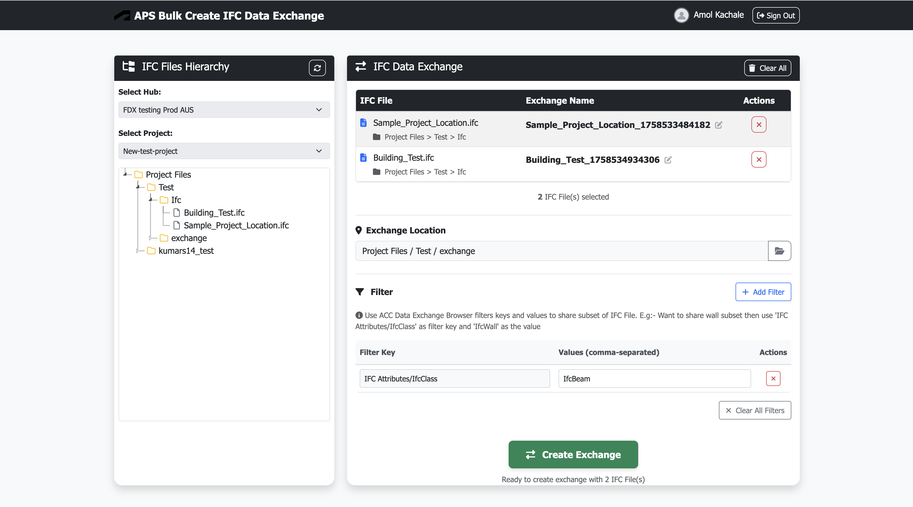

<!-- archived-notice -->
> **This repository is archived.** Archived repositories are not maintained or supported.

<!--
/////////////////////////////////////////////////////////////////////
// Copyright 2025 Autodesk Inc
// APS Bulk Create IFC Data Exchange - Documentation
//
// Permission to use, copy, modify, and distribute this software in
// object code form for any purpose and without fee is hereby granted,
// provided that the above copyright notice appears in all copies and
// that both that copyright notice and the limited warranty and
// restricted rights notice below appear in all supporting
// documentation.
//
// AUTODESK PROVIDES THIS PROGRAM "AS IS" AND WITH ALL FAULTS.
// AUTODESK SPECIFICALLY DISCLAIMS ANY IMPLIED WARRANTY OF
// MERCHANTABILITY OR FITNESS FOR A PARTICULAR USE.  AUTODESK, INC.
// DOES NOT WARRANT THAT THE OPERATION OF THE PROGRAM WILL BE
// UNINTERRUPTED OR ERROR FREE.
/////////////////////////////////////////////////////////////////////
-->

# APS Bulk Create IFC Data Exchange

## Description
This sample demonstrates bulk creating IFC data exchanges using Autodesk Platform Services (APS) with authentication and file hierarchy management. The application allows users to efficiently create multiple IFC data exchanges within a single project and folder structure within Autodesk Construction Cloud (ACC).

## Thumbnail

## Prerequisites

- [APS credentials](https://aps.autodesk.com/en/docs/oauth/v2/tutorials/create-app) (use `http://localhost:3000/api/aps/callback/oauth` as callback URL, take note of you Client ID and Client Secret)
- Provisioned access to [ACC Account](https://aps.autodesk.com/en/docs/bim360/v1/tutorials/getting-started/manage-access-to-docs/) (use Client Id from above)
- [Node.js](https://nodejs.org) (we recommend the Long Term Support version)
- Terminal (for example, [Windows Command Prompt](https://en.wikipedia.org/wiki/Cmd.exe)
or [macOS Terminal](https://support.apple.com/guide/terminal/welcome/mac))

## Running locally

Install [NodeJS](https://nodejs.org), version 18.16.0 or newer.

Clone this project or download it. It's recommended to install [GitHub desktop](https://desktop.github.com/). To clone it via command line, use the following (**Terminal** on MacOSX/Linux, **Git Shell** on Windows):

    git clone https://github.com/Autodesk-Platform-Services/aps-bulk-ifc-data-exchange

Install the required packages using `npm install`.

**Environment variables**

Set the enviroment variables with your client ID & secret and finally start it. Via command line, navigate to the folder where this repository was cloned and use the following:

Mac OSX/Linux (Terminal)   

    npm install
    export APS_CLIENT_ID=<<YOUR CLIENT ID FROM DEVELOPER PORTAL>>
    export APS_CLIENT_SECRET=<<YOUR CLIENT SECRET>>
    export APS_CALLBACK_URL=http://localhost:3000/api/aps/callback/oauth

    npm start

Windows (use **Node.js command line** from Start menu)

    npm install
    set APS_CLIENT_ID=<<YOUR CLIENT ID FROM DEVELOPER PORTAL>>
    set APS_CLIENT_SECRET=<<YOUR CLIENT SECRET>>
    set APS_CALLBACK_URL=http://localhost:3000/api/aps/callback/oauth

    npm start

Windows (use **PowerShell**)

    npm install
    $env:APS_CLIENT_ID="YOUR CLIENT ID FROM DEVELOPER PORTAL"
    $env:APS_CLIENT_SECRET="YOUR CLIENT SECRET"
    $env:APS_CALLBACK_URL=http://localhost:3000/api/aps/callback/oauth
    
    npm start

## Using the app

Open the browser: [http://localhost:3000](http://localhost:3000). 

1. **Select Project**: Choose your ACC hub and project from the available options
2. **Select IFC Files**: Navigate to the desired folders and select up to 10 IFC files for exchange creation
3. **Choose Destination**: Select a single folder location within the project where you want to create the IFC data exchanges
4. **Configure Filters**: Add appropriate filters using ACC Data Exchange Browser filter keys and values
5. **Create Exchange**: Click `Create Exchange` to initiate the IFC data exchange creation process
6. **Monitor Progress**: Track the exchange creation progress directly in ACC

## Troubleshooting

General [APS Support form](https://aps.autodesk.com/en/support/get-help).

## License
This sample is licensed under the terms of the [MIT License](http://opensource.org/licenses/MIT).
Please see the [LICENSE](LICENSE) file for more details.

## Written by
- Amol Kachale, Software Developer 
